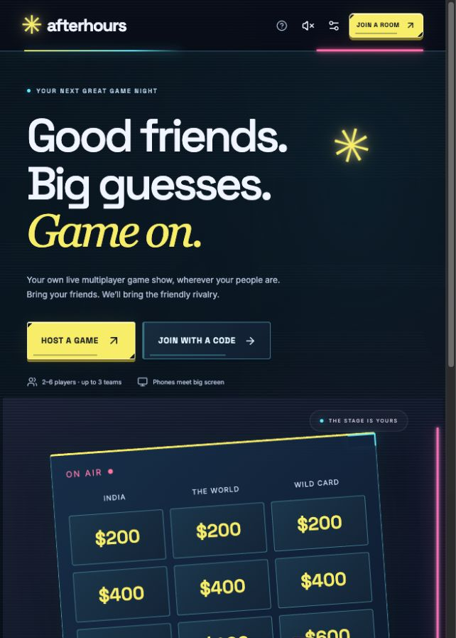
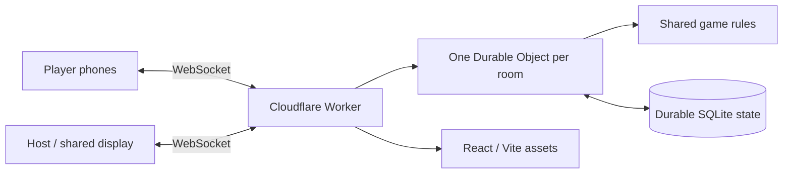

<div align="center">

# Afterhours

**Your phone is the buzzer. Your friends are the competition.**

A real-time multiplayer trivia game show for 2–6 people, with a neon 2D board, individual buzzers and an authoritative server.

[Play the hosted demo](https://afterhours-game-show.afterhours-game-show.workers.dev/) · [Run locally](#run-locally) · [Bring your questions](#bring-your-own-questions) · [Deploy](docs/DEPLOYMENT.md)

[](https://github.com/akshatdhabi/afterhours/actions/workflows/ci.yml)
[](LICENSE)


</div>



## The game

Create a private room, send the link and play from phones, laptops or a shared TV. Players do not need accounts. The host can run the show and play from the same phone.

- **2–6 players**, with individual scores or 2/3 balanced teams. Every player has their own buzzer.
- **One board, then Final:** six categories, five values, one hidden Daily Double and a private wager question.
- **Player-controlled selection:** the last correct player picks next. The player who uncovers a Daily Double owns its wager and answer.
- **Synchronized opening:** connected players acknowledge readiness before a shared countdown. The first valid buzz received by the server wins.
- **Server-controlled results:** answer grading, scores, penalties, wagers, deadlines and permissions are checked on the server.
- **Phone-first controls:** tactile tiles, large buzzer, readable native text, keyboard support, visible focus and reduced-motion settings.
- **Original synthesized audio:** phase-specific music and result cues, with optional browser announcements and device-level mute controls.
- **Recovery:** refresh/reconnect in the same browser to restore your seat. Rooms expire after 12 hours by default.

**Question content is intentionally separate.** This repository does not contain the hosted game's question library, its authoring sources or answer keys. It starts with a blank pack. Import your own questions before starting a game. The hosted demo is deployed separately and has its own private content.

## Run locally

Use **Node.js 24+** and npm:

```sh
git clone https://github.com/akshatdhabi/afterhours.git
cd afterhours
npm ci
cp .env.example .env
npm run dev
```

Open [localhost:3000](http://localhost:3000), create a room and choose **Edit or import questions**. Upload CSV/JSON or fill in the blank editor. Starting remains disabled until the pack is valid and the selected seats are filled.

For phones on the same Wi-Fi, open your computer's LAN address on **every device**, including the host, for example `http://192.168.1.20:3000`. `localhost` on a phone points to that phone.

No Cloudflare login, external database or API key is required for local play. Local room state is stored in the ignored `data/` directory.

## Bring your own questions

### Write a CSV

1. Download the [blank CSV template](public/question-pack-template.csv). It contains no question text or answer keys.
2. Open it in Excel, Google Sheets or another spreadsheet editor.
3. Fill all 30 board rows and the Final row. Keep the six categories and five values per category.
4. Export as **UTF-8 CSV**.
5. In the room lobby, open **Edit or import questions → Import CSV or JSON**, review the draft and save it.

| Column                  | What to enter                                                                |
| ----------------------- | ---------------------------------------------------------------------------- |
| `category`              | The category name; six board categories with five questions each             |
| `value`                 | One each of `200`, `400`, `600`, `800`, `1000` per category; blank for Final |
| `question`              | Your question text                                                           |
| `option_a` … `option_d` | Four distinct answer choices                                                 |
| `correct`               | `A`, `B`, `C` or `D`                                                         |
| `daily_double`          | `true` on exactly one board row; otherwise `false`                           |
| `final`                 | `true` on exactly one row; otherwise `false`                                 |
| `attribution`           | Optional source/license notice; retained in pack exports                     |

Commas, quoted text, multiline cells and spreadsheet BOMs are supported. Imports reject incomplete boards, duplicate choices, invalid keys and malformed values without replacing the current draft. The same pack is validated again on the server. Files are limited to 145 KB in the UI.

### Fetch an independent public pack

The optional downloader uses [Open Trivia DB](https://opentdb.com/api_config.php), **not the hosted Afterhours library**. It requires no API key:

```sh
npm run questions:fetch
```

It fetches a 31-question pack and writes `content/opentdb.csv` and `content/opentdb.json`. Review either file, then import it in the lobby. The `content/` directory is ignored by Git. Do not force-add private packs.

You can choose six Open Trivia DB category IDs:

```sh
npm run questions:fetch -- 9,17,22,23,11,21
```

Requests are spaced to respect the provider's rate limit. Availability and question quality depend on the external service. Its three difficulty labels are sorted into board order; review and adjust the five value tiers for your audience. This is not the demo's curated collection.

Open Trivia DB data is **CC BY-SA 4.0**. The downloader preserves attribution; retain it and follow the data license when sharing adapted packs. Application code remains MIT licensed. You can instead write original questions or use another source whose reuse terms permit your intended use.

See [question-pack format](docs/QUESTION-PACKS.md) for JSON and [content handling](docs/QUESTION-LIBRARY.md) for privacy and licensing.

## How it stays in sync



The client sends intentions: select a clue, buzz, choose an answer, submit a wager. It cannot replace game state or award points. Each room serializes accepted changes, persists them and then broadcasts a separate view for each session. Unused clues, answer keys and other sides' Final submissions are withheld from guest views.

The Node development server uses the same rules with Express, `ws` and built-in SQLite. A Node deployment must run one process/replica per database. Cloudflare uses one authority per room and hibernating WebSockets. See [architecture](docs/ARCHITECTURE.md) and [game rules](docs/EXPERIENCE.md).

## Deploy

The included Cloudflare setup serves the frontend and multiplayer backend from one URL:

```sh
npx wrangler login
npm run deploy
```

Use your own Cloudflare account and check `wrangler.jsonc` before deploying. SQLite-backed Durable Objects are provisioned through the included migration. No runtime API secrets are needed. Free-plan usage is quota-limited; consult the provider's current allowances.

[Deployment guide](docs/DEPLOYMENT.md) covers Cloudflare, an optional Netlify frontend and a single-process Node/Docker deployment. Pushing to GitHub runs checks; it does **not** deploy the hosted demo.

## Development and checks

| Command                   | Purpose                                                        |
| ------------------------- | -------------------------------------------------------------- |
| `npm run dev`             | Local React + Node game server                                 |
| `npm test`                | Rules, CSV validation and actual multi-client WebSocket tests  |
| `npm run check`           | Tests and production frontend build                            |
| `npm run test:cloud`      | Multiplayer and restart recovery in Cloudflare's local runtime |
| `npm run check:cloud`     | Production build and Worker deployment dry-run                 |
| `npm run format`          | Format maintained source and docs                              |
| `npm run questions:fetch` | Fetch a separate public-source pack into ignored local storage |

Tests use synthetic labels, not production questions. Coverage includes simultaneous buzz races, private Final entries, stale/unauthorized actions, score convergence, reconnection, non-captain Daily Double ownership and runtime restart recovery. CI runs formatting, tests, Worker bundling and the Cloudflare runtime suite without deployment credentials.

```text
src/             React interface, CSS, audio and clock synchronization
server/          Shared game rules, validation and local Node transport
worker/          Cloudflare routing, Durable Objects and rate gates
public/          Self-hosted fonts, icons and blank CSV template
scripts/         Optional external question downloader
test/           Synthetic fixtures and rule/integration tests
docs/            Rules, architecture, deployment and pack authoring
```

## Limits worth knowing

- A shared GO timestamp reduces opening-time differences; upload latency still affects first-arrival buzzing. This is not a latency-neutral tournament system.
- Sessions belong to their browser. Clearing site data or switching devices loses that recovery path; there is no automatic host election.
- A playing host can see answer keys for adjudication. Use a separate emcee for competitive games.
- Room codes permit joining/spectating; keep them within your group. Expired rooms are deleted.
- Imported packs are stored with the room and visible through host-authenticated export. The host's JSON export contains answer keys.
- There is no built-in voice/video or offline multiplayer. Browser audio needs a user gesture; speech voices vary by device.

See [security](SECURITY.md), [contributing](CONTRIBUTING.md) and [third-party notices](THIRD_PARTY_NOTICES.md).

## License

Application code and blank templates: [MIT](LICENSE). Fonts retain their SIL Open Font License notices. Independently sourced question packs retain their own licenses; fetching or importing one does not relicense it as MIT.

An independent project, unaffiliated with Jeopardy! or its owners.
